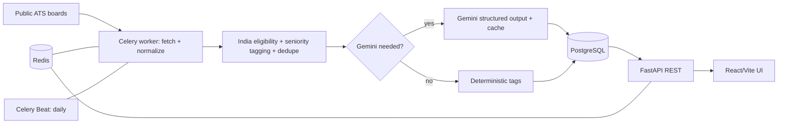

# FreshersJob Radar

**Real jobs in India — from first job to next move.**

FreshersJob Radar is a local-first, production-oriented job discovery platform for job seekers in India at every career stage. It collects real postings from public company career endpoints, keeps every India-eligible role (internship through experienced), tags seniority and role, removes duplicates, AI-tags what it can, and serves everything through a searchable React app with an experience-level filter. Applications always happen on the **employer's own website**.

> No fabricated jobs. No fake salaries. No invented posting dates. Every listing keeps its original source link.

---

## 1. What is included

- **FastAPI backend** with search, filters, sorting, pagination, stats, auth, saved jobs, preferences and protected admin endpoints.
- **PostgreSQL schema + Alembic migration** with full-text and trigram indexes.
- **Five ATS adapters**: Greenhouse, Lever, Ashby, Workable, SmartRecruiters — all public endpoints only.
- **Ingestion pipeline**: fetch → normalize → India eligibility → seniority scoring → dedupe → Gemini classification → upsert → freshness.
- **Celery worker + Beat** for daily ingestion, hourly freshness and 6-hour source health checks.
- **Gemini structured-output classifier** with Pydantic validation, content-hash caching and token metering.
- **React + TypeScript + Tailwind frontend** with landing, search, detail, saved, preferences, about, login and admin pages.
- **Tests** for deterministic logic, API, and UI.
- **Cost tooling** for measured token spend and USD per 1,000 posts.

---

## 2. Architecture



Detailed notes: [`docs/architecture.md`](docs/architecture.md).

### Data flow rules

1. Only public, unauthenticated endpoints are used. No anti-bot or paywall bypass.
2. Location, experience extraction and relevance screening are deterministic and auditable.
3. Gemini is used only for role/level/skills/ambiguous-city tagging, with cached content hashes.
4. A source fetch failure **never** expires a job; only repeated successful misses do.
5. `posted_at` and `first_seen_at` are separate and never invented.

---

## 3. Repository layout

```
fresherjobs-radar/
├─ apps/
│  ├─ api/                 FastAPI app, models, ingestion, AI, workers, tests
│  └─ web/                 React + Vite app
├─ scripts/
│  ├─ seed_sources.py      seed candidate public ATS boards (no jobs)
│  ├─ check_sources.py     probe sources and report India yield
│  ├─ disable_dead_sources.py  disable 404/empty boards after validation
│  ├─ run_ingestion.py     run one ingestion cycle with mounted host code
│  ├─ refresh_tags.py      recompute deterministic role tags in place
│  ├─ create_admin.py      create/reset the admin dashboard account
│  └─ cost_report.py       measured Gemini cost + USD per 1,000 posts
├─ docs/                   architecture, runbook, sources, api, cost
├─ docker-compose.yml      postgres + redis + api + worker + beat + web
├─ .env.example            all configuration (copy to .env)
└─ README.md               this file
```

---

## 4. Prerequisites

| Requirement | Version used |
|---|---|
| Docker Desktop (with Compose v2) | 29.x or newer |
| Python (only for host-side scripts/tests) | 3.12+ recommended; 3.11+ works |
| Node.js (only for host-side frontend dev) | 20+ |
| Google Gemini API key | required for AI tagging |

Check:

```powershell
docker --version
python --version
node --version
```

---

## 5. Quick start (step by step — Windows PowerShell)

### Step 1 — Open the project

```powershell
cd "D:\Resume Projects\fresherjobs-radar"
```

### Step 2 — Create your environment file

```powershell
copy .env.example .env
notepad .env
```

Set **at minimum**:

```dotenv
GEMINI_API_KEY=your_real_key_here
SECRET_KEY=a-long-random-string
```

Keep `.env` out of git (it is already in `.gitignore`). The key is read only by the backend.

### Step 3 — Start all services

```powershell
docker compose up -d --build
```

This starts:

| Service | URL | Purpose |
|---|---|---|
| `web` | http://localhost:8080 | React app |
| `api` | http://localhost:8000 | FastAPI + Swagger at `/docs` |
| `worker` | — | Celery ingestion/classification |
| `beat` | — | scheduled tasks |
| `postgres` | localhost:5432 | database |
| `redis` | localhost:6379 | broker + cache |

The API container automatically runs `alembic upgrade head` before starting.

### Step 4 — Confirm health

```powershell
docker compose ps
curl http://localhost:8000/api/v1/health
```

Expected: `{"status":"ok","database":"ok","redis":"ok"}`.

### Step 5 — Seed candidate sources

Run the script inside the API image with the repo mounted:

```powershell
docker compose run --rm -v "${PWD}:/repo" -w /repo api python scripts/seed_sources.py
```

This inserts **source configuration only** (company + ATS board identifiers). No jobs are created.

### Step 6 — Validate which sources are actually usable

```powershell
docker compose run --rm -v "${PWD}:/repo" -w /repo api python scripts/check_sources.py
```

You will see raw counts, India-eligible counts and errors per source. Disable dead boards with:

```powershell
docker compose run --rm -v "${PWD}:/repo" -w /repo api python scripts/disable_dead_sources.py
```

Expand the registry in `scripts/seed_sources.py` if you need more coverage. See `docs/sources.md` for the measured validation table. **Never pad the number with invented jobs.**

### Step 7 — Run the first ingestion

```powershell
docker compose run --rm -v "${PWD}:/repo" -w /repo api python scripts/run_ingestion.py
```

Wait for the run to finish. It prints counts for raw, normalized, candidate, new, updated, duplicates and classified jobs.

### Step 8 — Open the app

- UI: http://localhost:8080
- API docs: http://localhost:8000/docs
- Stats: http://localhost:8000/api/v1/stats

You should now see real jobs in **Latest opportunities** and on the **Explore jobs** page.

### Step 9 — Create an admin account (optional, for the admin dashboard)

```powershell
$env:ADMIN_EMAIL = "admin@example.com"
$env:ADMIN_PASSWORD = "choose-a-strong-password"
docker compose run --rm -e ADMIN_EMAIL -e ADMIN_PASSWORD -v "${PWD}:/repo" -w /repo api python scripts/create_admin.py
```

This uses `scripts/create_admin.py` (avoids fragile PowerShell one-liners). Re-run it to reset the password; it also promotes an existing user to admin.

A demo admin account is already created in the local database:

```
Email:    demo@fresherjobs.com
Password: demo1234
```

Use it to sign in and open the admin dashboard. You can also register a normal
account through the login page; registration is open because this is a local demo.

### Step 10 — Let the daily refresh run

Celery Beat is already running in Compose. It triggers `ingestion.ingest_all` once per day (02:00-equivalent interval of 86,400s from container start), plus hourly freshness and 6-hour source health checks. You can also trigger ingestion from **Admin → Run ingestion** or `POST /api/v1/admin/ingestion/run`.

---

## 6. Configuration reference

All values are in `.env.example`. Important ones:

| Variable | Meaning |
|---|---|
| `DATABASE_URL` | async Postgres DSN (host `postgres` inside Docker) |
| `DATABASE_SYNC_URL` | sync DSN for Alembic/scripts |
| `REDIS_URL`, `CELERY_BROKER_URL`, `CELERY_RESULT_BACKEND` | Redis DB indexes |
| `GEMINI_API_KEY`, `GEMINI_MODEL` | backend-only AI credentials |
| `GEMINI_MAX_DESCRIPTION_CHARS` | description truncation to bound cost |
| `INGEST_CONCURRENCY`, `HTTP_TIMEOUT_SECONDS`, `HTTP_MAX_RETRIES` | fetch behaviour |
| `MAX_JOBS_PER_SOURCE` | per-source ingestion cap |
| `STALE_AFTER_MISSES`, `EXPIRE_AFTER_DAYS_UNCONFIRMED` | freshness rules |
| `NEW_JOB_DAYS` | "New" badge window |

---

## 7. Using the application

| Page | Path | What it does |
|---|---|---|
| Landing | `/` | Hero search, live stats, latest jobs, methodology |
| Explore jobs | `/jobs` | Debounced search, filters, sort, pagination, save buttons |
| Job detail | `/jobs/{id}` | Full description, classification, provenance, direct apply link |
| Saved | `/saved` | Private saved list (requires login) |
| Preferences | `/preferences` | Roles, skills, locations, experience, remote preference |
| About | `/about` | Sourcing, classification, limitations |
| Login | `/login` | Email register/login |
| Admin | `/admin` | Source health, ingestion runs, AI metrics (admin role) |

Filters are stored in the URL so searches are shareable. Job descriptions are rendered as **plain text** — HTML/scripts from sources are never executed.

---

## 8. Source management

- View health: **Admin → Sources**, or `GET /api/v1/admin/sources`.
- Toggle a source: admin button, or `POST /api/v1/admin/sources/{id}/toggle`.
- Add a platform: create `apps/api/app/ingestion/fetchers/<platform>.py`, register in `factory.py`, add a `sources` row.
- Re-check yield: `scripts/check_sources.py`.

Respect each site's terms, robots.txt and rate limits. The fetcher sends a descriptive User-Agent, retries with backoff, honours `Retry-After`, and isolates failures per source.

---

## 9. AI classification and cost control

- Model: Gemini (default `gemini-3.8-flash`), structured JSON validated by Pydantic.
- Only India-eligible postings are classified.
- Cache: SHA-256 of normalized title + description, Redis TTL 30 days, plus a DB record per classification.
- Untrusted input: the posting is delimited and the prompt instructs the model to ignore instructions inside it.
- Confidence is a triage signal, **not** a calibrated probability; the UI labels tags as AI-assisted.

Cost report:

```powershell
docker compose run --rm -v "${PWD}:/repo" -w /repo api python scripts/cost_report.py
```

This writes `docs/cost.md` with measured tokens, estimated USD spend and **USD per 1,000 posts**. Prices are configurable approximations in `apps/api/app/ai/metering.py`; verify them against the current Gemini price sheet before publishing.

---

## 10. Testing

Backend unit tests (no database needed):

```powershell
docker compose exec api pytest
```

Backend API tests (needs running DB; set the flag):

```powershell
docker compose exec -e RUN_DB_TESTS=1 api pytest app/tests/test_api.py
```

Frontend tests (host Node):

```powershell
cd apps\web
npm install
npm test
```

Full frontend build:

```powershell
npm run build
```

---

## 11. Project workflow

### Development loop

```
edit code -> docker compose up -d --build -> run tests -> check logs -> repeat
```

- API code changes require `docker compose restart api`.
- Worker/Beat code changes require `docker compose restart worker beat`.
- Schema changes: add an Alembic revision, then `docker compose exec api alembic upgrade head`.

### Data loop (daily, automated by Beat)

```
fetch sources -> normalize -> India check -> seniority tagging -> dedupe -> Gemini (cached)
-> upsert jobs -> freshness decisions -> run metrics -> searchable UI
```

### Quality loop

```
check_sources.py -> fix/disable sources -> ingest -> cost_report.py -> publish numbers
```

### What to check before claiming a number

- Real ingestion run completed (`/api/v1/admin/ingestion-runs`).
- Job count comes from `GET /api/v1/stats`, not from a hardcoded value.
- Seniority counts come from `GET /api/v1/stats` and reflect real postings.
- Cost uses measured token counts from the `classifications` table.

---

## 12. Troubleshooting

| Problem | Fix |
|---|---|
| `health` shows degraded | Check `docker compose logs postgres redis` |
| No jobs after ingestion | Run `check_sources.py`; inspect `sources.last_error` and run counts |
| Search returns 500 | `docker compose exec api alembic current` — apply migrations |
| AI tags are "Unknown" | Confirm `GEMINI_API_KEY` in `.env`; check `jobs.classification_failed` |
| Celery tasks never execute | Check `docker compose logs worker beat`; confirm Redis URL |
| Frontend cannot reach API | Use port 8080 (nginx proxies `/api`), or port 5173 with Vite proxy |
| PowerShell here-string issues | Put multi-line Python in a `.py` file and run it via `docker compose run` |
| Reset everything | `docker compose down -v` then start from Step 3 |

---

## 13. Security notes

- Secrets live only in `.env` (gitignored) and backend settings; never in the frontend bundle.
- Passwords hashed with Argon2id; JWT in HttpOnly cookie plus CSRF double-submit token.
- User-specific endpoints verify ownership; admin endpoints require the `admin` role.
- Pydantic validation on all inputs, allowlisted sort fields, capped pagination.
- Job descriptions are untrusted: stored as plain text and rendered as plain text.
- Outbound links are scheme-checked (`http`/`https`) with `rel="noopener noreferrer"`.

---

## 14. Known limitations

- Public ATS coverage varies by company; some boards are US-centric and yield few India roles. Volume (currently ~690 live jobs) depends on real source yield — expand the registry rather than inventing data. Early-career roles are rarer in ATS feeds than experienced ones; the Experience filter makes that visible instead of hiding it.
- Posting dates are shown only when the source supplies them.
- AI classification can be wrong; confidence is not a probability.
- Job alert infrastructure exists in the DB but email delivery is not configured.
- Local-first profile uses `secure=False` cookies; enable Secure cookies behind HTTPS in production.

---

## 15. Command cheat sheet

```powershell
# start / stop
docker compose up -d --build
docker compose down
docker compose down -v                 # destructive: deletes DB

# logs
docker compose logs -f api worker beat

# database
docker compose exec api alembic upgrade head
docker compose exec api alembic current

# ingestion tasks
docker compose run --rm -v "${PWD}:/repo" -w /repo api python scripts/seed_sources.py
docker compose run --rm -v "${PWD}:/repo" -w /repo api python scripts/check_sources.py
docker compose run --rm -v "${PWD}:/repo" -w /repo api python scripts/run_ingestion.py

# cost report
docker compose run --rm -v "${PWD}:/repo" -w /repo api python scripts/cost_report.py

# tests
docker compose exec api pytest
docker compose exec -e RUN_DB_TESTS=1 api pytest app/tests/test_api.py
```

---

## 16. Deploy to Vercel

The same stack also deploys as a single Vercel project with two Services
(`apps/web` + `apps/api`) on one shared domain. FastAPI runs as a function,
Celery tasks run through Vercel Queues, Celery Beat is replaced by Vercel Cron,
and Postgres/Redis are external services. The root `vercel.json` holds the
service routing, function timeout and cron schedules.

See [`docs/deployment.md`](docs/deployment.md) for the full runbook: dumping and
restoring the real job database, the required environment variables, the admin
password reset, and the post-deploy smoke test. Docker Compose remains the
local development path.

---

**FreshersJob Radar** — real opportunities, direct applications, transparent data.
