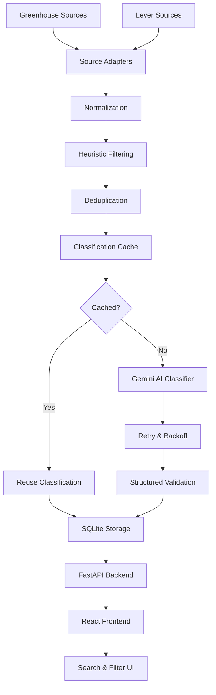

# FreshersJob Radar 🎯

An AI-powered job discovery platform that collects job listings from multiple company career boards, filters for fresher-relevant opportunities in India, classifies them using Gemini, and provides a searchable web interface.

## Problem

Finding fresher-friendly jobs is noisy and time-consuming. Job boards contain experienced roles, irrelevant locations, duplicate postings, and listings that use ambiguous titles such as "Associate" or "Intern."

FreshersJob Radar automates collection, filtering, deduplication, classification, and discovery.

## Features

- **Multi-source ingestion:** Fetches jobs from Greenhouse and Lever career boards.
- **Heuristic filtering:** Reduces the large raw job pool to potentially relevant listings before AI processing.
- **Deduplication:** Removes duplicate listings across collected data.
- **AI classification:** Uses Google Gemini to classify role category, city, experience level, job type, and fresher-friendliness.
- **Structured output:** Validates AI output with Pydantic.
- **Classification cache:** Avoids repeated LLM calls for previously classified content.
- **Retry & backoff:** Handles temporary API errors and capacity/rate-limit issues.
- **Persistent storage:** Stores jobs and classifications in SQLite.
- **Searchable frontend:** Search and filter listings by relevant criteria.
- **Automated proxy audit:** Independently evaluates a sample of AI classifications to measure agreement.

## Architecture



## Pipeline

1. **Fetch:** Collect job postings from configured public career board endpoints.
2. **Normalize:** Convert source-specific data into a common job structure.
3. **Filter:** Apply heuristic rules to remove irrelevant postings.
4. **Deduplicate:** Identify duplicate listings.
5. **Cache lookup:** Check whether the job has already been classified.
6. **AI classification:** Use Gemini for uncached jobs.
7. **Validation:** Validate structured classification output.
8. **Retry:** Retry transient failures with backoff.
9. **Persist:** Upsert jobs and classification results into SQLite.
10. **Serve:** Expose jobs through the API for the React application.

## Tech Stack

### Backend

- Python 3.11
- FastAPI
- SQLite
- HTTPX
- Google Gemini API (`google-genai`)
- Pydantic
- python-dotenv

### Frontend

- React
- TypeScript
- Vite
- CSS

## AI Classification

Gemini classifies each candidate job into structured fields:

| Field                 | Description                                                       |
| --------------------- | ----------------------------------------------------------------- |
| `role_category`       | Broad professional category                                       |
| `city`                | Normalized city or Remote                                         |
| `experience_level`    | Internship, Entry Level, Experienced, or Unknown                  |
| `job_type`            | Full-time, Internship, Part-time, Contract, or Unknown            |
| `is_fresher_friendly` | Whether candidates with little/no experience can reasonably apply |
| `confidence`          | Model-estimated confidence                                        |
| `reasoning`           | Short explanation for the decision                                |

The classifier does not rely solely on keywords such as "Associate," "Junior," or "Intern." It considers the posting's requirements and experience expectations.

Job descriptions are treated as untrusted data. Classification uses structured output validation.

## Caching and Reliability

### Classification cache

Previously classified content is cached to avoid unnecessary Gemini API calls. This reduces repeated processing, latency, and cost.

### Retry strategy

Transient model/API errors such as rate limits, service unavailability, and resource exhaustion are retried with exponential-style wait intervals.

### Concurrency controls

AI classification concurrency is limited and requests are paced to reduce API overload.

### Persistence

Jobs are stored in SQLite using upsert behavior, allowing refreshes without blindly duplicating records.

## API

The FastAPI backend exposes:

| Endpoint                             | Purpose                               |
| ------------------------------------ | ------------------------------------- |
| `GET /api/jobs`                      | Search and retrieve jobs              |
| `GET /api/jobs/{source}/{source_id}` | Retrieve an individual job            |
| `GET /api/stats`                     | Job database statistics               |
| `/docs`                              | Interactive Swagger API documentation |

Local API documentation:

`http://127.0.0.1:8000/docs`

## Latest Pipeline Run

Latest observed ingestion run:

| Metric                   | Result |
| ------------------------ | -----: |
| Sources configured       |     23 |
| Raw jobs collected       |  5,221 |
| Passed heuristic filters |     53 |
| Unique jobs              |     52 |
| Classified & stored      |     52 |
| Fresher-friendly results |     12 |
| Cache hits               |     49 |
| Cache misses             |      3 |
| Actual Gemini calls      |      3 |

The pipeline reduced 5,221 raw postings to 52 unique candidate jobs for classification.

## Automated Proxy Audit

A separate AI evaluator assessed a reproducible sample of 20 jobs.

| Metric          |  Result |
| --------------- | ------: |
| Sample size     |      20 |
| Agreement       | 19 / 20 |
| Proxy agreement |     95% |
| TP              |       5 |
| TN              |      14 |
| FP              |       1 |
| FN              |       0 |
| Proxy precision |  83.33% |
| Proxy recall    |    100% |
| Proxy F1        |  90.91% |

The audit flagged an AI Researcher Intern role that was originally classified as fresher-friendly despite advanced qualification and specialized experience requirements.

**Limitation:** These are proxy metrics based on a second AI evaluator, not human-verified ground truth. They measure model agreement and should not be presented as validated real-world classification accuracy.

Audit output is generated in CSV format for inspection.

## Estimated AI Cost

Cost estimates use assumed average token usage and the pricing assumptions used during development. Actual costs depend on token consumption, model pricing, caching, and API tier.

Assumptions per uncached job:

- Input: approximately 2,000 tokens
- Output: approximately 150 tokens

Estimated classification cost:

| Volume                  | Estimated cost |
| ----------------------- | -------------: |
| 1,000 classified jobs   |         $0.975 |
| 10,000 classified jobs  |          $9.75 |
| 100,000 classified jobs |         $97.50 |

The latest run classified 52 unique jobs, with only 3 actual Gemini calls due to cache hits.

At the observed filtering rate, the estimated AI cost is approximately **$0.01 per 1,000 raw collected postings**, assuming similar filtering rates and token usage.

These are estimates, not measured billing costs. Exact token usage is not yet captured in the pipeline.

## Project Structure

```text
freshersjob-radar/
├── backend/
│   ├── app/
│   │   ├── pipeline/
│   │   │   ├── greenhouse.py
│   │   │   ├── lever.py
│   │   │   ├── sources.py
││   │   │   ├── filters.py
││   │   │   ├── dedup.py
││   │   │   ├── classifier.py
││   │   │   ├── classification_cache.py
││   │   │   ├── runner.py
││   │   │   └── job_storage.py
││   │   └── api_jobs.py
││   ├── data/
││   │   └── (local SQLite databases)
││   ├── automated_audit.py
││   ├── .env
││   └── requirements.txt
├── frontend/
│   └── (React + TypeScript application)
├── .gitignore
└── README.md
```

## Setup

### Prerequisites

- Python 3.11+
- Node.js and npm
- Gemini API key

### 1. Clone the repository

```bash
git clone https://github.com/shreyansh018/freshersjob-radar.git
cd freshersjob-radar
```

### 2. Backend setup

```bash
cd backend
python -m venv .venv
```

Activate the environment on Windows Git Bash:

```bash
source .venv/Scripts/activate
```

Install dependencies:

```bash
pip install -r requirements.txt
```

Create `backend/.env`:

```env
GEMINI_API_KEY=your_gemini_api_key
GEMINI_MODEL=your_configured_gemini_model
```

Start the API:

```bash
uvicorn app.main:app --reload
```

Backend:

`http://127.0.0.1:8000`

Swagger:

`http://127.0.0.1:8000/docs`

### 3. Frontend setup

In a new terminal from the repository root:

```bash
cd frontend
npm install
npm run dev
```

Open the local URL printed by Vite, commonly:

`http://localhost:5173`

### 4. Run ingestion

From the backend directory, run the ingestion pipeline using the project runner's configured entry point.

The pipeline fetches, filters, deduplicates, classifies, and persists jobs.

## Security

- API keys are stored locally in environment variables.
- `.env` files are excluded from Git.
- Local databases are excluded from Git.
- Job descriptions are treated as untrusted input during AI classification.

Never commit API credentials.

## Limitations & Future Improvements

- Source coverage depends on publicly accessible career-board endpoints.
- Not all collected roles will be fresher-friendly.
- Classification quality can vary with incomplete or ambiguous job descriptions.
- Proxy audit agreement is not a substitute for human ground-truth evaluation.
- Exact LLM token usage and billing are not currently logged.
- Source coverage and filtering rules can be expanded.

Potential improvements:

- Add measured token usage and cost tracking.
- Expand verified career board sources.
- Improve India-specific location and eligibility detection.
- Add monitoring for source failures and data freshness.
- Improve classification with targeted evaluation examples.
- Add a human-review feedback loop for uncertain jobs.

## Demo

The demo can follow this flow:

1. Show the website and explain the problem.
2. Search for jobs using a keyword.
3. Demonstrate city/role filters.
4. Show the FastAPI endpoints.
5. Explain the ingestion pipeline architecture.
6. Run or show ingestion logs.
7. Explain filtering and deduplication.
8. Demonstrate Gemini structured classification.
9. Show cache hits and retry handling.
10. Present the automated proxy audit and limitations.

## License

Created as a take-home project.
